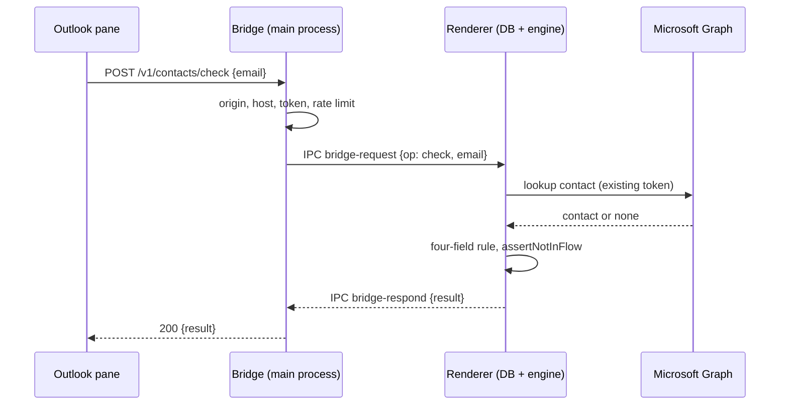

# HDF-Plug: Bridge API (contract, version 1)

This is the only interface between the Outlook add-in and HoneyDue-Flow (HDF). It is a small HTTP/JSON API served by HDF on the user's own computer. Both sides are built and tested against this file. `PLAN.md` explains why it exists and `RESEARCH.md` the facts behind it.

Status: **revision 6. Every endpoint in this file is built and tested in HDF 1.2.0 (release v1.2.0; tests `BRG-`) and used by the add-in (tests `PLG-`). Changes since revision 5: a new `502 contacts_unavailable`, the window time-out is 25 seconds, and a `check` of a person already in a flow with no readable cadence name returns an empty `flow` object.**

## 1. Transport and rules

| Item | Value |
|---|---|
| Address | `https://localhost:<port>`, port from `47615` to `47624` (first free one in HDF). Bound to the loopback address only, never `0.0.0.0`. **Plain `http` is not offered: Outlook on Mac refuses it (RESEARCH D)** |
| Certificate | A self-signed certificate HDF creates for this computer when the user presses **Set up** in Settings, Outlook Add-in (names: `localhost`, `127.0.0.1`; not a CA; server use only; valid 365 days and renewed when under 30 days remain; key kept in HDF's user-data folder, never in the database or a backup). The user approves trust once (own keychain on Mac, Current User store on Windows, no administrator). **Until Set up is done the port is closed, so the add-in sees HDF as "not detected"; the add-in's message for that state must say where to look (PLAN state 1).** See PLAN H10 |
| Format | JSON in, JSON out, `Content-Type: application/json; charset=utf-8` |
| Version | Path prefix `/v1`. `hello` also returns `apiVersion` |
| Auth | `Authorization: Bearer <token>` on everything except `hello` and `connect` |
| CORS | `Access-Control-Allow-Origin` echoes the request's origin only if it equals **one constant in HDF**: the GitHub Pages address of the add-in page (an origin has no path: `https://007style.github.io`). Never `*`. A request that **has** any other `Origin` gets no CORS headers and a `403 forbidden_origin`. A request with **no** `Origin` header at all (not a web page; for example a person or a tool) may call `hello` only; `connect`, its status call and `OPTIONS` need the allowed Origin, and every other endpoint needs a token |
| Preflight | `OPTIONS` answered `204` with `GET, POST, DELETE, OPTIONS`, headers `Authorization, Content-Type`, and `Access-Control-Allow-Private-Network: true`, only for the allowed Origin |
| Host header | Must be `127.0.0.1:<port>` or `localhost:<port>`, else `403` (DNS rebinding) |
| Body size | 8 KB maximum, else `413` |
| Timeout | HDF answers within 10 seconds (server-side header and request timeouts) or the add-in treats it as "not detected" |
| Time | Date-times are ISO 8601 UTC strings (`2026-11-20T14:00:00.000Z`), as in HDF's own Add Flow modal |
| Logging | HDF logs that a call happened and its result code. It does **not** log email addresses or names |

### Error shape (all errors)
```json
{ "ok": false, "error": { "code": "unauthorized", "message": "Connect this add-in to HoneyDue-Flow first." } }
```
`message` is plain words the add-in may show as is.

| HTTP | `code` | Meaning |
|---|---|---|
| 400 | `bad_request` | Missing or malformed field |
| 401 | `unauthorized` | No token, wrong token, or revoked. Add-in goes to state 3 |
| 403 | `forbidden_origin` / `forbidden_host` | Origin or Host check failed |
| 403 | `bridge_off` | Switched off in HDF Settings (state 4). Every endpoint except `hello` and `OPTIONS` answers this; `hello` still answers, see below |
| 404 | `not_found` | (also) An unknown path or method, for a caller with a token or without |
| 404 | `not_found` | Unknown path or cadence |
| 409 | `already_in_flow` | Contact already has a pending step |
| 409 | `cadence_off` | Cadence is switched off (missing template) |
| 413 | `too_large` | Body over 8 KB |
| 423 | `connect_locked` | Too many denied or timed-out connect requests, try later (`retryAfterSeconds` included) |
| 409 | `connect_busy` | Another connect request is already waiting for the user's answer |
| 424 | `not_connected` | HDF is not signed in to Microsoft 365 (state 5) |
| 429 | `rate_limited` | Too many calls (60 per minute, all callers together) |
| 500 | `internal` | Anything else. Message is generic |
| 502 | `contacts_unavailable` | HDF could not read the Outlook address book (Microsoft Graph failed). Nothing was changed; try again |
| 504 | `app_busy` | HDF window did not answer within 25 seconds |

## 2. Endpoints

### 2.1 `GET /v1/hello`  (no auth)
Used to detect HDF and its readiness. Answers even when the bridge is off, so state 4 can be told apart from state 1.

```json
{
  "ok": true,
  "app": "HoneyDue-Flow",
  "appVersion": "1.2.0",
  "apiVersion": 1,
  "bridgeEnabled": true,
  "connection": "connected",
  "connected": false
}
```
- `app` must equal `"HoneyDue-Flow"`; the add-in rejects any other answer on that port.
- `connection` is `connected`, `disconnected` or `error` (Microsoft 365 sign-in, reported by the HDF page to the main process; `connected` only when the connection mode is Microsoft 365 and `oauth_status` is `connected`; `error` when the page has not reported or reports anything else).
- `connected` is whether **this** call's token is valid. Without a token it is `false`.
- Never contains the signed-in address, a name, or a token.

### 2.2 `POST /v1/connect` and `GET /v1/connect/{requestId}`  (no auth)
Connecting needs **no code typed**. The add-in asks, HDF shows one **Allow / Deny** prompt to the user, and the add-in collects the answer.

Step 1, the add-in asks:
```json
{ "clientName": "Outlook (new, Windows)" }
```
Reply, at once:
```json
{ "ok": true, "requestId": "r_9f2c1a", "expiresInSeconds": 60 }
```
Step 2, the add-in asks `GET /v1/connect/{requestId}` (the id looks like `r_` plus 12 hex characters; any other shape is `404`) every 1 second until the answer arrives:
```json
{ "ok": true, "status": "pending" }
```
```json
{ "ok": true, "status": "allowed", "token": "<64 hex characters>" }
```
`status` is one of `pending`, `allowed`, `denied`, `expired`. The token is returned **once**: a second ask for the same request answers `expired`. HDF keeps only a hash. An unknown request id is `404 not_found`.

Rules:
- The request is refused with `403 forbidden_origin` and **no prompt is shown** unless the Origin is the add-in's own (section 1).
- HDF brings its window to the front (showing it if it was hidden in the tray) and asks with a **system dialog from the main process**, so no page can fake or auto-answer it. The dialog names the add-in client and says what it can do: "check your Outlook contacts and add people to flows". The buttons are Deny and Allow; Deny is the default and Escape is Deny. The dialog closes by itself when the request expires or the bridge is switched off.
- Only one request waits at a time (`409 connect_busy`). The request expires after 60 seconds.
- 3 denials or time-outs in a row refuse further requests for 10 minutes (`423 connect_locked`).
- `clientName` is shown in the prompt and in HDF's list of connected add-ins, 1 to 40 plain characters (no control characters), so the user can revoke the right one. Anything else is `400 bad_request` and no prompt is shown.
- HDF stores only a SHA-256 hash of the token (`bridge.json` in the user-data folder, mode 600, outside the database and outside backups). A damaged `bridge.json` is read as "nobody is connected".

### 2.3 `POST /v1/contacts/check`  (auth)
Asks whether a person on the email can go into a flow.

Request:
```json
{ "email": "jane@acme.com" }
```
Response, always HTTP 200 for the four business outcomes, so the add-in does not treat them as failures:
```json
{ "ok": true, "result": "eligible",
  "contact": { "displayName": "Jane Doe", "email": "jane@acme.com", "company": "Acme" } }
```
```json
{ "ok": true, "result": "not_in_contacts" }
```
```json
{ "ok": true, "result": "missing_fields", "missing": ["last name", "company"],
  "contact": { "displayName": "Jane" } }
```
```json
{ "ok": true, "result": "already_in_flow",
  "contact": { "displayName": "Jane Doe" }, "flow": { "cadenceName": "Intro" } }
```
Rules:
- `missing` uses exactly these words: `first name`, `last name`, `company`, `email`.
- Order of checks: signed in (else `424`), in Outlook contacts, four fields present, not already in a flow.
- `already_in_flow` carries `flow.cadenceName`, or an empty `flow` object when the flow's name cannot be read (a single step has no cadence).
- `eligible` carries `contact.email`: the address HDF will actually use. If it differs from the request (the match was on a second address) the add-in shows "Emails will go to ...".
- `contact` is present only when an Outlook contact was found, and it describes that one contact. The API never returns more than one.
- Matching is case-insensitive, against every address on the Outlook contact, in every contact folder.

### 2.4 `GET /v1/flow-options`  (auth)
Everything the pane can offer, in one call.
```json
{
  "ok": true,
  "cadences": [
    { "id": "cad_ab12cd3", "name": "Intro", "stepCount": 4, "firstChannel": "email", "active": true },
    { "id": "cad_ef45gh6", "name": "Re-engage", "stepCount": 3, "firstChannel": "call",
      "active": false, "inactiveReason": "Step 2 needs the email template 'Follow up', which was deleted." }
  ],
  "templates": [
    { "id": "tpl_1a2b3c4", "name": "Quick check-in", "channel": "email" },
    { "id": "tpl_5d6e7f8", "name": "Cold call script", "channel": "call" },
    { "id": "tpl_9a0b1c2", "name": "Connect note", "channel": "linkedin" }
  ],
  "noScriptCall": true
}
```
- Live from HDF's database, in the same order as HDF's Cadences and Templates tabs.
- Cadences with no steps are left out (HDF refuses them).
- **Templates carry only id, name and channel, never the body.** A single-step start is a channel plus one template.
- `noScriptCall: true` means a phone call may be started without a script, as in HDF's own Add Flow window. The pane then shows "Phone call, no script".
- The pane shows two groups, "Multi-step" (cadences) and "Single step" (templates, plus the no-script call). The search box filters both in the pane, with no server call.
- Unknown fields must be ignored by the add-in, so new kinds can be added later without breaking old add-ins.

### 2.5 `POST /v1/schedule/check`  (auth)
Lets the pane show HDF's own warning without copying its rules.
```json
{ "kind": "cadence", "cadenceId": "cad_ab12cd3", "scheduledDatetime": "2026-11-20T14:00:00.000Z" }
```
or, for a single step:
```json
{ "kind": "template", "channel": "email", "scheduledDatetime": "2026-11-20T14:00:00.000Z" }
```
```json
{ "ok": true, "inPast": false, "held": true,
  "reason": "Weekend Shield is on: no emails go out on Saturday or Sunday.",
  "nextAllowed": "2026-11-23T13:00:00.000Z" }
```
- `held` and `nextAllowed` follow `checkScheduleTime`; they apply only when the first step is an email (a cadence's first step, or `channel: "email"`), as in HDF's own screen.
- `held: false` omits `reason` and `nextAllowed`.

### 2.6 `POST /v1/flows`  (auth)
Puts the person into the flow. The only call that changes anything.
```json
{ "email": "jane@acme.com", "kind": "cadence", "cadenceId": "cad_ab12cd3",
  "scheduledDatetime": "2026-11-20T14:00:00.000Z" }
```
or, a single step (`templateId` is required for `email`; for `call` it may be left out; for `linkedin` the pane sends the chosen template, as in HDF's own window):
```json
{ "email": "jane@acme.com", "kind": "template", "channel": "email", "templateId": "tpl_1a2b3c4",
  "scheduledDatetime": "2026-11-20T14:00:00.000Z" }
```
Success:
```json
{ "ok": true, "contact": { "displayName": "Jane Doe" },
  "flow": { "name": "Intro", "kind": "cadence" }, "firstStepAt": "2026-11-20T14:00:00.000Z",
  "calendarNote": "" }
```
What HDF does, in this order (the same function the In Flow tab uses, extracted in change H1):
1. Re-run the contact check (the Outlook contact may have changed since the pane opened). If it fails, nothing is changed and the error below is returned.
2. Import or update the person as a local contact (`syncExternalContacts` logic, source `outlook`, status `unassigned`).
3. For `kind: "cadence"`: `resumeContactFlow(contactId, cadenceId, 1, scheduledDatetime)`, which also checks that the cadence exists, is not switched off, and the contact is not in a flow. For `kind: "template"`: `assertNotInFlow`, then one pending step with the channel and template, exactly as HDF's own Add Flow window does for "Single Follow-up".
4. Sync calendar and to-dos, refresh the screen, show HDF's usual toast.

Failures:
- Not in contacts or missing fields: `409` with `error.code` = `not_eligible` and `error.detail` = `{ "result": "not_in_contacts" }` or `{ "result": "missing_fields", "missing": [...] }`, using the words from 2.3.
- Already in a flow: `409 already_in_flow`.
- Cadence switched off: `409 cadence_off`. Cadence or template deleted: `404 not_found`.
- `kind` missing or unknown, or an email single step with no `templateId`: `400 bad_request`.
- Date missing or not parseable: `400 bad_request`.

`calendarNote` is HDF's "Problems: ..." text when the calendar could not be updated, or an empty string. The add-in shows it as a warning, not an error, because the contact **is** in the flow.

### 2.7 `DELETE /v1/connect`  (auth)
The add-in forgets its connection and HDF removes that token (only the caller's own). Revoking from HDF Settings does the same on the HDF side. Answer: `{ "ok": true }`; without a valid token `401`.

## 3. Behaviour guarantees

| Guarantee | How it is held |
|---|---|
| A double press never makes two flows | HDF refuses a second pending flow (`AlreadyInFlowError`); `flows` is safe to retry |
| HDF closed mid-call | Add-in gets a network error and shows state 1 |
| Stale answer after the user changes email | The add-in ignores any reply whose request id is not the latest |
| Old add-in, new HDF (or the reverse) | `apiVersion` mismatch gives state 2; HDF keeps serving `/v1` while a `/v2` is introduced |
| Bridge switched off | Port closes. `hello` is the only thing that still answers when the port is open but the feature is off |
| The add-in can never read more than it needs | No endpoint lists contacts, templates, notes, settings or tokens |

## 4. HDF internals the API sits on (for H3 to H7)



- **Built (part 1):** six IPC names for the Settings card and the sign-in state: `bridge-get-state`, `bridge-set-enabled`, `bridge-setup`, `bridge-revoke`, `bridge-remove-certificate` (all invoke) and `bridge-report-connection` (send), in the approved lists (TESTPLAN 12.8).
- **To build (part 2):** `bridge-request` (main to renderer) and `bridge-respond` (renderer to main), added to **both** approved lists or `ELE-33` and `ELE-45` fail.
- The renderer answers only five `op` names: `status` (for `hello`), `check`, `flowOptions`, `scheduleCheck` and `addFlow`. An unknown `op` is refused. No `op` accepts a script, a file path or a URL (test `ELE-31` keeps passing).

## 5. Test cases this contract creates (ids are proposed; they enter `TESTPLAN.md` as `TODO`)

| Id | Case |
|---|---|
| BRG-H01 | `hello` answers with app, versions, flags; no personal data |

*The ids below are the proposal from revision 4. The built tests use the ids in HDF's TESTPLAN section 12.10 (`BRG-R` rules, `BRG-C` certificate, `BRG-H` hello, `BRG-A` transport and auth, `BRG-P` connect, `BRG-S` controller, `BRG-D` Allow / Deny, `BRG-X` safety, `BRG-W` main-process handlers). The data-endpoint cases below get their own letters when part 2 is built.*

| BRG-H02 | `hello` answers while the bridge is off, with `bridgeEnabled: false` |
| BRG-P01 to P07 | Connect: allowed (token returned once), denied, expired after 60 s, wrong Origin gives no prompt, second request while one waits, three denials lock for 10 minutes, `clientName` too long |
| BRG-A01 to A06 | Auth: no token, bad token, revoked token, wrong origin, wrong Host, `OPTIONS` preflight headers |
| BRG-C01 to C09 | Check: eligible, not in contacts, each missing field alone, all four missing, already in flow, match on second address, Out Flow person, not signed in, case-insensitive |
| BRG-L01 to L06 | Flow options: cadence order, empty lists, inactive cadence with reason, cadence with no steps left out, templates carry no body, `noScriptCall` |
| BRG-S01 to S04 | Schedule check: in past, held by weekend, held by business hours, allowed |
| BRG-F01 to F12 | Flows: cadence success, **single-step success for email, call with a script, call with no script and LinkedIn**, run twice, contact changed since check, cadence off, cadence or template deleted, email single step with no template, unknown `kind`, bad date, calendar problem returned as a note, two requests at once |
| BRG-X01 to X04 | Safety: body too large, unknown `op`, bridge turned off closes the port, port busy picks the next |
| UI-SET-xx | Settings card: switch, the Allow / Deny prompt, list of connected add-ins, revoke, port shown, "start when I sign in" |
| DRV-xx | `lookupContactByEmail` on the Windows driver (fake Graph), simulator, fake, Mac "not supported" |

Every test runs against `127.0.0.1` with a fake renderer and a fake driver. None touch Microsoft or send mail.
