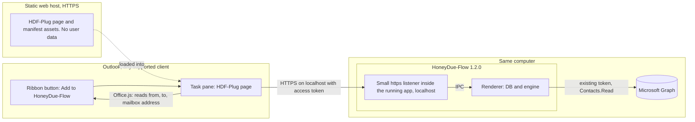

# HDF-Plug: Project Plan

Project: **HDF-Plug**, an Outlook add-in for **HoneyDue-Flow (HDF)**.
Target HDF version: 1.1.0 today, the bridge ships in **1.2.0**.
Status: **plan only (revision 2, after your review answers of 2026-11-16). No code is written until this plan is approved.**
Companion files: [`RESEARCH.md`](RESEARCH.md) (what was checked and how sure we are), [`BRIDGE-API.md`](BRIDGE-API.md) (the contract between the add-in and HDF).

---

## 1. What we are building

A button in Outlook. While the user is looking at an email, they press **Add to HoneyDue-Flow**. A side panel opens that:

1. Finds the person on that email (the sender on a received email, the recipient on a sent email).
2. Checks that the person is an **Outlook contact with first name, last name, email and company**. If not, the panel does not show the form. It shows a plain message saying why (no greyed button is needed; decided by the user in revision 3).
3. If the person qualifies, lets the user **search for and pick a flow** (a multi-step cadence or a single-step template), pick a **start date and time**, and press **OK**.
4. The person is put into HDF's In Flow, exactly as if they had been added inside HDF.
5. If HDF is not installed, not running, or not set up, the panel says so and nothing else is offered.

## 2. What the research changed in the brief

Three things differ from what was imagined. All are in [`RESEARCH.md`](RESEARCH.md).

| You asked for | What is possible | What we do |
|---|---|---|
| The ribbon button is **greyed out** when the contact does not qualify | Microsoft documents the enable/disable API and manifest switch for **Excel, PowerPoint and Word only**, not Outlook (RESEARCH A2) | The ribbon button is always clickable. It opens a side panel. **The panel shows a plain "cannot be added" message naming the reasons.** One click shows the reason. No greyed control is needed (user decision, revision 3). Spike S1 re-checks this on a live Outlook |
| Add-in reads the contact from Outlook | Office.js has no contacts API (A6) | HDF already reads Outlook contacts through Microsoft Graph (`Contacts.Read`) and already applies the four-field rule. **The add-in asks HDF.** No second sign-in |
| Support old Outlook "if easy" | Same web add-in runs in classic Outlook on Windows (A1) | **Yes, supported at no extra build cost.** Testing cost only |

### 2.1 Your review answers and what they changed (revision 2)

| Your answer | What it means | Effect on the plan |
|---|---|---|
| v1 handles **multi-step cadences and single-step templates** | HDF's "Single Follow-up" is one channel (email, phone call, LinkedIn) plus one template | The picker lists both groups. The bridge `kind` field is used in v1 (sections 3, 5.1; API 2.4 to 2.6) |
| "Source on GitHub. What is GitHub Pages?" | Source and hosting are two different things | Explained in section 11 |
| "Can't it **auto pair**?" | Yes, with no code typing. The first time, HDF shows one **Allow / Deny** prompt | Sections 8.3, 9; API 2.2. The bridge is now **on by default** |
| Must support Outlook on **PC and Mac** | Mac moves from "if the spike passes" to a **release blocker** | Sections 3, 10, 13, 14. Plan B (4.1) is now more likely to be needed |
| "Just **write to the database**? Put the server **inside the running HDF**? If HDF is not running, add to the database so it picks it up" | The listener **is** inside the running HDF (that was already the plan). Writing to the database from outside is not possible | Sections 4.2 (why), 4.3 (when HDF is not running) |
| "Why host it anywhere? I will install it from my GitHub page" | Outlook always loads the panel from a web address, so the page must be served from somewhere. HDF itself can be that place | Section 4.1 |
| "No greyed button needed. Show the reasons when it is clicked" | Matches what Outlook allows (spike S1 confirmed on Mac) | Sections 2, 5 |

### 2.2 What the Phase 0 spike found on Outlook for Mac (revision 3)

Full table in `RESEARCH.md` section D. In short:

| Finding | Effect on the plan |
|---|---|
| The ribbon cannot be greyed (`Office.ribbon` is undefined) | Nothing: the plan already shows the reason in the panel |
| Sender and recipients can be read | Nothing: works as planned |
| **A plain `http://127.0.0.1` or `http://localhost` listener cannot be called** | **HDF's listener must be `https://localhost`** with a certificate the user trusts once. New change H10 |
| An https page can call an https `localhost` listener, including a preflighted POST with a token | The API design holds, only the transport changes |
| The page that calls HDF was itself on `localhost` in this test | **Open: does it still work from a page on a public web address?** |
| `honeydue-flow://` link: nothing happened (nothing registered) | The "Open HoneyDue-Flow" button is dropped from v1 |

## 3. Scope

### In v1
- New Outlook on Windows **and Outlook on Mac**: both are required, both are release blockers.
- Outlook on the web and classic Outlook on Windows: same code, **supported once spike S2 passes in that client** (section 14). If one fails the spike it is listed as unsupported and does not hold up the release.
- Microsoft 365 and Outlook.com mailboxes (Outlook add-ins do not run on Gmail or IMAP accounts, A8; HDF does not support them on Windows either).
- Choose a **flow**: a multi-step **cadence**, or a **single-step template** (an email, a LinkedIn message, or a phone call with or without a script), then a start date and a start time.
- States: HDF not detected, not connected, HDF not signed in to Microsoft 365, contact not eligible (with reason), no flows, already in a flow, success, error.
- Same computer only: Outlook and HDF must be on the same machine.

### Single-step templates (decided: in v1)
HDF has two ways to start a contact: a multi-step **cadence**, or a **single follow-up** (a channel plus one template). Both are offered. In the panel the list has two headed groups, "Multi-step" and "Single step". A phone call may have no script, so the single-step group also holds "Phone call, no script", as HDF's own Add Flow window does. The add-in sends `kind: "cadence"` or `kind: "template"`; HDF runs the same code path as its own Add Flow window for each.

### Out of v1 (stated so nobody assumes them)
- Outlook mobile (HDF is a desktop app, there is nothing local to talk to).
- Adding people who are **not** in Outlook Contacts, or filling in missing fields from the add-in. The add-in never writes to Outlook (HDF itself never does, per `winDriver.ts`).
- Removing, pausing or editing a flow from Outlook.
- Several contacts at once (multi-select).
- Microsoft Marketplace (AppSource) listing. v1 is installed from a manifest file or by an admin.
- Gmail or IMAP accounts.

## 4. Architecture



**Why this shape**
- The page is hosted, because Outlook loads add-ins from a URL (RESEARCH A10). The page holds **no data and no secrets**.
- All real work happens inside HDF, which owns the database (B1), the Microsoft sign-in (B3) and the rules (B4). The add-in is a thin remote control. That keeps the rules in one place and means the add-in cannot drift out of step with HDF.
- Auth lives in the main process (a small `bridge.json` in the user-data folder holding only a **hash** of each approved token, so it can never end up in an exported backup). Data requests are passed to the renderer, which already has the database (B1).

### 4.1 Where the add-in page is served from (DECISION NEEDED, Q2/Q11)
The Mac spike showed the listener must be https (section 2.2). That leaves two ways to serve the page Outlook shows in its panel:

| | **A. Page on a public web host** (recommended) | **B. Page served by HDF itself** ("Plan B") |
|---|---|---|
| Where the page lives | A small static site, free on GitHub Pages if the `HDF-Plug` repository is public. It holds no data or secrets. HDF's own repository stays private | HDF serves it from `https://localhost:<port>` |
| Manifest address | The public address | `https://localhost:<fixed port>` (one fixed port, not a range) |
| Hosting needed | Yes, one free static host | **No** |
| HDF closed | **Friendly message works**: the page loads from the web, finds no HDF, and says so (your requirement) | **Outlook cannot load the page at all and shows its own generic error.** The friendly message cannot be shown |
| Page calling HDF | Cross-origin call from a public page to `https://localhost`. Works on Mac only if the test is repeated from a public origin; Windows unknown | Same origin, the simplest and safest call |
| Updating the page | Publish a new version, everyone gets it | Ships inside each HDF release |
| Extra install step | Certificate approval in HDF (both options) | Same |

Recommendation: **A**, because the "HDF is not running" message is a stated requirement and only A can show it. **B** is the fallback if a page from a public origin turns out not to be allowed to call `https://localhost` on Windows or Mac. Phase 0 round 2 settles this (section 14).

In both options the user approves the local certificate once (H10). The certificate is a single-purpose, self-signed server certificate for `localhost` that **cannot sign other certificates**, so it cannot be used to impersonate any other site.

### 4.2 Why the add-in cannot write to HDF's database directly
1. **The add-in is sandboxed.** It runs in a web view inside Outlook and has no access to files on the computer. It can only make web requests (RESEARCH A11).
2. **HDF's database is not a file you can open.** It is a SQLite database held in memory inside the HDF window (sql.js), saved as one block of text in the window's browser storage (`Local Storage/` in HDF's data folder). While HDF runs it owns that copy and rewrites the whole block on every save, so an outside edit would be overwritten or would corrupt it. HDF's own README says that data "is not a file you can open directly" (RESEARCH B7).
3. **Adding a person to a flow is more than one table row.** It imports the person from Outlook (that needs HDF's Microsoft token), checks the rules (already in a flow, cadence switched off, four required fields), creates calendar and to-do entries, and refreshes the screen. All of that is HDF's code.
4. **So the plan puts a small listener inside the running HDF**, which is what you proposed. It is not a separate program, service or install. In these documents "bridge" means that listener plus its rules.

### 4.3 When HDF is not running
With HDF closed nothing can answer: nobody can look up the Outlook contact (that needs HDF's token), list HDF's flows, or write to its data. The panel therefore says "not detected". To make that rare:

| Option | In v1? | What it is |
|---|---|---|
| A. **Start HoneyDue-Flow when I sign in** | **Yes** (change H9) | New HDF setting. HDF already hides to the tray when its window is closed, and its scheduler only works while it runs anyway, so this is a good setting on its own merits |
| B. **Open HoneyDue-Flow** button in the panel | **No** (dropped; S7 inconclusive) | Would need HDF to register a `honeydue-flow://` link. The panel just tells the user to open HDF. Can be added later |
| C. **Queue the request** and let HDF take it next time it opens | **No** (Q10) | The add-in cannot check the four fields or read HDF's flow list while HDF is closed, so mistakes would surface later and silently. The flow also could not start until HDF runs, because the scheduler only runs in the app. It can be added later; the API leaves room for it |

## 5. User experience

### 5.1 The panel

```
+------------------------------------------+
| HoneyDue-Flow                      [pin] |
+------------------------------------------+
| Person on this email                     |
|  (o) Jane Doe  <jane@acme.com>           |   shown as a list when a sent email has
|  ( ) Raj Patel <raj@acme.com>            |   more than one recipient
+------------------------------------------+
| Flow  [ search flows...            ]     |
|   Multi-step                             |
|   > Intro, 4 steps, starts with email    |
|     Re-engage, 3 steps                   |
|   Single step                            |
|     Email: Quick check-in                |
|     Phone call: Cold call script         |
|     Phone call, no script                |
| Start  [ 2026-11-20 ]  [ 9:00 AM ]       |
|   (warning line when the time is in the  |
|    past or would be held by HDF's shields|
+------------------------------------------+
|        [ Cancel ]      [ OK, start flow ]|
+------------------------------------------+
```

**Not eligible** (the form is not shown; the panel shows the reason instead):

```
|  Jane Doe can't be added to a flow       |
|  jane@acme.com is not in your Outlook    |
|  contacts.                               |
|                                [ Close ] |
```

The message is ordinary panel text, so it works with a keyboard, a screen reader and every Outlook client.

### 5.2 Which person
- **Received email:** the sender (`from`).
- **Sent email:** the recipients (`to`, then `cc`), excluding the user's own address. One recipient: used. Several: listed with a radio choice and each shows its own eligibility.
- Mail from or to the user alone, or a message with no usable address: "No other person on this email."
- Matching is by email address, case-insensitive, against **any** address on the Outlook contact.

### 5.3 State table (every state the panel can be in)

| # | State | Detected by | Panel shows | Controls |
|---|---|---|---|---|
| 1 | **HDF not detected** | No bridge answers on any port in the range, or the answer is not HDF | "HoneyDue-Flow was not detected on this computer. It must be installed and running before you can use this add-in. If it is installed, open it. It may be hidden in the system tray." plus a Download link and a **Try again** button | none |
| 2 | HDF too old / add-in too old | `/hello` apiVersion not in the supported range | "Update HoneyDue-Flow to 1.2.0 or later" (or "Update the add-in") | none |
| 3 | **Not connected yet** | No token, or the bridge says unauthorized | "Connect this add-in to HoneyDue-Flow." A **Connect** button. After pressing it: "Switch to HoneyDue-Flow and click **Allow**" with a **Cancel** button. No code to type. A denied or expired request shows "Not allowed" or "Timed out" and **Try again** | **Connect**, **Cancel** |
| 4 | Add-in switched off in HDF | `/hello` says `bridgeEnabled: false` | "The Outlook add-in is switched off in HoneyDue-Flow Settings." | none |
| 5 | HDF not connected to Microsoft 365 | `/hello` connection not `connected` | "HoneyDue-Flow is not signed in to Microsoft 365. Sign in from its Settings." | none |
| 6 | No person on the email | Office.js | See 5.2 | none |
| 7 | **Not in Outlook contacts** | `check` returns `not_in_contacts` | Message: "{email} is not in your Outlook contacts, so it can't be added to a flow." | none |
| 8 | **Missing fields** | `check` returns `missing_fields` and the list | Message: "This Outlook contact is missing: last name, company. Add them in Outlook, then reopen this panel." | none |
| 9 | **Already in a flow** | `check` returns `already_in_flow` | Message: "{name} is already in the flow '{cadence}'. A contact can be in only one flow at a time." | none |
| 10 | No flows to choose | `flow-options` returns no cadences and no templates | "There are no flows or templates yet. Create one in HoneyDue-Flow first." | none |
| 11 | Eligible | `check` returns `eligible` | The form in 5.1 | active |
| 12 | Flow chosen is switched off | cadence `active: false` | Item greyed in the list with its `inactiveReason` as the (i) text | not selectable |
| 13 | Submitting | user pressed OK | Spinner, OK disabled (prevents a double click) | disabled |
| 14 | **Success** | `flows` returns ok | "Jane Doe is in 'Intro'. First step: Fri Nov 20, 9:00 AM." | **Done** |
| 15 | Failure | any error | The message HDF returned, plain words, plus **Try again** | active |

Reason texts are held in one table in the add-in and covered by a test, so wording changes in one place.

### 5.4 Names and wording
Ribbon label: **Add to HoneyDue-Flow**. Group label: **HoneyDue-Flow**. Pane title: **HoneyDue-Flow**. Texts avoid jargon ("cadence" appears as "flow" in the pane, to match your wording; the list shows each flow's step count).

## 6. Eligibility rule (the contract)

A person is eligible when **all** hold. They are checked inside HDF, in this order, and the first failure is the one reported:

1. HDF is signed in to Microsoft 365 (otherwise state 5).
2. An Outlook contact (in the default folder or any contact folder, as `fetchContacts` already scans) has the address (otherwise `not_in_contacts`).
3. That contact has a non-empty **first name, last name, company** and **email** (otherwise `missing_fields`, listing which). This is the exact rule in `WinDriver.fetchContacts`; the plan reuses it so there is one definition.
4. The person has no pending step in HDF (otherwise `already_in_flow`), by `assertNotInFlow`.

**Edge case to handle:** HDF imports a contact's **first** non-empty address. If the email in Outlook matches a contact's second address, the person is eligible but HDF would write to the first address. The pane shows "Emails will go to {address}" whenever it differs from the address on the message.

**A person already in HDF's Out Flow** (stopped or finished) is eligible: `resumeContactFlow` already supports this, the same way the In Flow tab's Add Flow does.

## 7. Work stream H: changes in honeyDue-Flow (new version 1.2.0)

The honeyDue-Flow folder is its **own git repository**. All of this goes on a branch there (`feature/outlook-bridge`), following its `AGENTS.md` Feature Gate. HDF-Plug holds only the add-in, the docs and a fake bridge for development.

| # | Change | Files | Notes |
|---|---|---|---|
| H1 | **Pull the add-to-flow steps out of `App.tsx`** (`handleAddFlowSubmit`, lines 392 to 427) into one shared function (the cadence branch **and** the single-follow-up branch) used by the screen **and** the bridge | new `src/engine/addToFlow.ts`; `src/App.tsx` | Pure refactor, "no behavior change", existing tests must pass untouched. Do this first and ship it alone |
| H2 | **Single-address lookup in the driver:** `lookupContactByEmail(email)` returns the Outlook contact or the missing fields | `src/drivers/types.ts`, `winDriver.ts`, `simDriver.ts`, `fakeDriver.ts`; `macDriver` answers "not supported" like it does for tasks | Reuses the four-field rule. Spike S4 decides filter versus cache |
| H3 | **Bridge server** in the main process: **HTTPS** on the loopback address (name `localhost`), port range, endpoints in `BRIDGE-API.md`, request forwarding to the renderer | new `electron/bridge.ts`; `electron/main.ts` | Pure logic kept in `logic.ts` style so it can be tested without Electron |
| H4 | **Connection approval and token store** (`bridge.json`, hashed tokens, revoke) | `electron/bridge.ts` | Never written into the database or into backups |
| H5 | **IPC to the renderer:** `bridge-request` and `bridge-respond` | `electron/main.ts`, `electron/preload.ts`, `src/App.tsx` | Add the names to **both** approved lists (`ELE-33`, `ELE-45` fail otherwise). Add the matching `window.electronAPI` types (`X-STATIC-02`) |
| H6 | **Settings card "Outlook add-in":** on/off switch (default **on**), the **Allow / Deny** prompt shown when an add-in asks to connect (window comes to the front, or a notification if hidden), list of connected add-ins with Revoke, port in use, status | `src/components/modals/SettingsModal.tsx` | Info (i) pop-ups follow F-49 |
| H7 | **Read-only data operations** the bridge needs: list cadences (step count, first channel, `inactive_reason`) **and templates** (name, channel); schedule check using `checkScheduleTime` | `src/engine/addToFlow.ts` (calls existing `getCadences`, `checkScheduleTime`) | Reuses B6, no new rules |
| H8 | **Docs and test plan:** Feature Register row, new case ids (prefix `BRG-` for bridge, `UI-SET-` for the card, `DRV-` for the lookup), manual checklist item for real Outlook, README and DESIGN sections, `npm run testplan:write` and `testplan:check` | `TESTPLAN.md`, `README.md`, `DESIGN.md`, `package.json` version | Per `AGENTS.md` rule 2 |
| H9 | **"Start HoneyDue-Flow when I sign in"** setting (off by default, offered the first time the add-in is used) | `electron/main.ts`, `electron/preload.ts`, Settings card | Uses Electron's login-item feature. HDF has none today (RESEARCH B8). The `honeydue-flow://open` link was dropped from v1 (RESEARCH D) |
| H10 | **Local certificate:** HDF creates a self-signed certificate for `localhost` and `127.0.0.1` (not a CA, key never leaves the user-data folder, never in the database or a backup), asks the user to approve trust once, and renews it before it expires | new `electron/bridgeCert.ts`; Settings card shows status and a "Remove trust" button | Mac: trust in the user's own keychain (one password prompt). Windows: current-user trusted store (one confirmation). The exact commands, and what happens when the user refuses, are settled in Phase 0 round 2. Uses the system's own tools, no new dependency if avoidable |

Existing safeguards stay: the Electron window keeps `sandbox`, `contextIsolation` and its CSP (the bridge runs in the main process, B5). The listener is https, so the `http://` allowance in `X-STATIC-01` is not needed; Phase 1 re-checks that rule and `ELE-33`/`ELE-45`.

## 8. Work stream A: the add-in (in `HDF-Plug/`)

### 8.1 Technology
| Part | Choice | Reason |
|---|---|---|
| Language | TypeScript | Same as HDF |
| UI | React 18 + Tailwind CSS | Same as HDF, so the look matches and the team knows it |
| Build | Vite | Same as HDF |
| Outlook API | Office.js (loaded from Microsoft's hosted `office.js`, as Microsoft requires) | Required for an Outlook add-in |
| Manifest | **Add-in-only XML manifest** | Works in new and classic Windows, web **and Mac**. The unified manifest does not support Outlook on Mac (RESEARCH A7) |
| Permission | **ReadItem** | Reads sender and recipients, cannot change mail (RESEARCH A5) |
| Tests | Vitest + Testing Library, fake Office.js, fake bridge | Same tools as HDF |

### 8.2 Folder layout (created in Phase 1, nothing is created now)
```
HDF-Plug/
├── RESEARCH.md
├── PLAN.md
├── BRIDGE-API.md
├── manifest/manifest.xml            Add-in manifest, one file
├── src/
│   ├── office/                      Office.js wrappers: current item, sender/recipients, ItemChanged
│   ├── bridge/                      Client for the bridge API, port discovery, token storage
│   ├── state/                       The state machine in section 5.3
│   ├── components/                  Panel, PersonPicker, FlowPicker, DateTime, InfoTip, banners
│   └── texts.ts                     Every message in one table
├── assets/                          Icons 16, 32, 80 px
├── tools/fake-bridge/               A small server that behaves like HDF, for development and tests
├── tests/
├── docs/INSTALL.md                  How a user installs it
└── package.json
```

### 8.3 How the panel behaves
- **Pinnable task pane** (`SupportsPinning`, requirement set 1.5). It stays open while the user clicks through messages. On each `ItemChanged` event it re-reads the item, then re-asks HDF. `item` can be `null` and the code must cope (RESEARCH A4).
- **Port discovery (option A):** the add-in tries a fixed range of ports (proposed `47615` to `47624`) on `https://localhost`, calling `/v1/hello` with a 1.5 second timeout each, and remembers the working one. It checks that the answer says `app: "HoneyDue-Flow"`. With option B there is one fixed port and no discovery.
- **Connecting (auto pair):** the add-in asks HDF to connect, HDF shows **Allow / Deny**, and the user clicks **Allow** once. Nothing is typed. The add-in stores the returned token in the pane's `localStorage`. Spike S5 shows how long it survives in each client; if a client loses it, that client simply asks again (state 3), which is the safe failure.
- **Time handling:** the date and time pickers work in local time. The add-in sends an ISO string, as HDF's own Add Flow modal does. The default is 30 minutes from now, same as HDF.
- **Schedule warning:** the add-in sends the chosen time to `schedule-check` and shows HDF's warning (past, or held by business hours or the weekend shield). It never reimplements the rules.
- **No double submit:** the OK button disables at once, and HDF also refuses a second add (`AlreadyInFlowError`).

## 9. Security

The bridge opens a door on the user's machine, so it is locked in layers. Each item becomes a test.

1. **On by default, switchable off in Settings.** Until an add-in is approved, the port answers only `hello` and a connect request. Nothing else is reachable without a token.
2. **Bound to the loopback address only**, never `0.0.0.0`. **https only**, with a single-purpose certificate (H10).
3. **Origin allow-list.** Only the add-in's own origin is accepted (set in HDF from a constant; the CORS header names that origin, never `*`). Other origins get no CORS headers.
4. **Host header check** (`127.0.0.1:<port>` or `localhost:<port>`) to defeat DNS rebinding.
5. **Approve-once connection + bearer token.** The add-in asks to connect and HDF shows **Allow / Deny**. Only on Allow is a token issued. The token is 256 random bits and only its **hash** is stored. A request from a wrong origin gets no prompt at all. One request at a time; after 3 denials or time-outs further requests are refused for 10 minutes. Why this is safe enough: a web page cannot forge its Origin, which stops other websites; another program on the same computer could forge it, but still cannot get a token without the user clicking Allow.
6. **Smallest possible surface.** The API can only: say hello, ask to connect, check a contact, list flow choices, check a time, and add a flow. It cannot read the contact list, template text, notes, tokens or settings, and cannot send mail.
7. **Local network permission headers.** Browsers that ask permission for a public page to reach the local network need `Access-Control-Allow-Private-Network: true` on the preflight reply. Not needed on Mac in the spike; Windows engines are tested in round 2.
8. **Privacy.** The page is static and sends nothing anywhere except to the local HDF. No analytics. Logs in HDF record that a request happened, not the email addresses (HDF's rule for logs).
9. **Revoke.** Settings can revoke any connected add-in, and switching the bridge off closes the port at once.

## 10. Test strategy

HDF's rule is that the test plan is the source of truth, and a feature is not done until its cases exist and pass. The same discipline applies here.

**honeyDue-Flow side (Vitest, in its repo, ids `BRG-xx`)**
- Bridge server on `127.0.0.1` with a fake renderer: every endpoint, normal path, failure path, boundaries, "run twice and at the same time".
- Security cases from section 9, one test each: wrong origin, wrong Host, no token, bad token, connect denied, connect timed out, repeated denials lock further requests, a second request while one is waiting, rate limit, bridge off, revoke.
- Eligibility: not in contacts, each missing field alone and together, email in a second address, already in flow, in Out Flow, cadence switched off, not signed in.
- H1 refactor: all existing tests pass untouched.
- No test uses real Microsoft, real tokens or the network (`AGENTS.md` rule 4).

**Add-in side (Vitest + fake Office.js + fake bridge)**
- One test per row of the state table (section 5.3).
- Sender/recipient selection: received, sent, several recipients, self only, none, `null` item, item switch while a request is in flight (a late answer for the old item must be ignored).
- Time zones: run under the same four time zones as HDF.
- Wording table: every state has a text.

**Manual matrix** (cannot be automated; kept as a checklist in `docs/` and mirrored in HDF's section 15.5)

| Client | Required result |
|---|---|
| **New Outlook on Windows** | All states, connect, add flow end to end. **Release blocker** |
| **Outlook on Mac (new UI)** | All states, connect, add flow end to end. **Release blocker** |
| Outlook on the web | Same, if S2 passes |
| Classic Outlook on Windows | Same, if S2 passes |
| Sent email, received email, reply, forwarded email | Correct person each time |
| HDF closed, HDF in tray, HDF window open | States 1 and 11 |

## 11. Packaging, hosting and install

- **Source and hosting are two different things.** Your **source code** lives in a GitHub repository, as you said. **Hosting** is where the *finished* add-in page is served from while people use it.
- **Why hosting is needed at all:** Outlook never keeps an add-in's program on your computer. The manifest holds a web address, and Outlook opens that address inside the side panel each time, like a browser tab (RESEARCH A10). So the built page (a few HTML, script and style files) must sit at a public `https://` address.
- **What GitHub Pages is:** a GitHub feature that publishes built files from a repository as a website, at `https://<account>.github.io/<repo>/`, for free, with HTTPS. A GitHub Action would build and publish on every release. The page holds no data and no secrets, so a public page is fine.
- **Update after the Mac spike:** hosting is needed only if you choose option A in section 4.1. If you choose B, HDF serves the page and none of the rest of this section about hosting applies.
- **A catch:** the `007Style/honeyDue-Flow` repository returns "not found" to anonymous requests, so it appears to be **private**. As far as I know, GitHub Pages on a private repository needs a paid GitHub plan. I could not check your plan. Options, in the order I would try them: (1) `HDF-Plug` source repo public, Pages free; (2) private source repo on a paid plan, Pages from it; (3) a tiny public repo containing only the built files; (4) another free static host (Cloudflare Pages, Netlify); (5) Plan B (4.1), where HDF serves the page itself and no hosting is needed. Decision Q2.
- **User install (v1):** download `manifest.xml`, then in Outlook open **Get Add-ins, My add-ins, Custom add-ins, Add from file**. Exact menu names differ by client and are written up from real testing in `docs/INSTALL.md` (spike S6).
- **Organization install:** an administrator uploads the manifest in the Microsoft 365 admin center (Integrated apps).
- **HDF install:** unchanged. Users update HDF to 1.2.0. The add-in is on by default; the first time the panel opens, the user clicks **Allow** in HDF once.
- **Versioning:** add-in `0.x` until the new-Outlook matrix passes, then `1.0.0`. The bridge has its own `apiVersion` (`1`) so either side can be updated alone; both sides refuse an apiVersion they do not know (state 2).

## 12. Detecting "HDF not installed"

A web page cannot tell "not installed" from "installed but not running". So the panel says what it knows and what to do:

> HoneyDue-Flow was not detected on this computer. It must be installed and running before you can use this add-in. If it is installed, open it. It may be hidden in the system tray. If it is not installed, download it here.

"Running" matters because HDF's scheduler only works while the app is open anyway (README, Known limits). To make this less likely HDF already hides to the tray on window close, not quit.

## 13. Risks

| Risk | Likelihood | Effect | Handling |
|---|---|---|---|
| An Outlook web view blocks the call from the page to HDF | **Mac: happened for plain http, https works from a local page. Windows and public-origin: unknown. Still the biggest unknown** | Option B (page served by HDF) loses the friendly "HDF not running" message | Phase 0 round 2 on Windows and with a public origin. Section 4.1 |
| User refuses the certificate approval | Medium | The add-in cannot work on that computer | The panel and Settings explain why it is needed and how to approve it later; nothing else in HDF is affected |
| The user's own address is not the mailbox address (a Gmail alias on an Outlook.com mailbox, seen in the spike) | Medium | The add-in may offer the user as the person, then say "not in contacts" | v1 treats the mailbox address and HDF's signed-in address as "me"; an alias list can come later |
| Outlook cannot grey a ribbon button | **Certain by docs** | Design change already made | Reason is shown in the pane; no greyed control (section 2) |
| HDF's database is in the renderer, so a hidden or crashed window cannot answer | Low | Requests time out | 10 second timeout, state 1 text, the renderer keeps running while hidden (B1) |
| Graph cannot filter contacts by email | Medium | Slower lookup | Use a short-lived cache from the full read HDF already does (S4) |
| Token lost when the pane's storage is cleared | Medium | Click Allow again | State 3 is a normal, friendly state |
| Outlook add-in manifest or API changes | Low | Rework | XML manifest is the long-supported form; keep Office.js use small and behind `src/office/` |
| Two Outlook accounts or a shared mailbox | Low | Wrong or no activation | Documented as a known limit (RESEARCH A9) |
| User changes the contact in Outlook after opening the pane | Medium | Stale state | Re-check on the OK press, return the fresh reason |
| Port range already used | Low | Add-in cannot find HDF | HDF picks the first free port in the range and shows it in Settings |
| Bridge on by default widens HDF's attack surface | Low | A local program could ask to connect | Approve-once prompt, origin check, prompt rate limit (section 9). Switchable off |
| Outlook cannot open `honeydue-flow://` links | Medium | No "Open HoneyDue-Flow" button | Option A (start at sign-in) still works; spike S7 |
| Uncommitted 1.1.1 changes in the honeyDue-Flow working tree | Certain today | Branch conflicts | Phase 1 starts after those are committed; the bridge ships as 1.2.0, after 1.1.1 |

## 14. Phases

| Phase | What | Output | Exit test |
|---|---|---|---|
| **0. Spike** (throwaway code) | Round 1 **done on Mac** (`RESEARCH.md` section D). **Round 2:** run on new Outlook for **Windows**; repeat the Mac test from a page on a **public web address**; quit-and-reopen Outlook storage check; settle the certificate commands (H10) | A filled-in matrix for Mac and Windows | Decision between options A and B (section 4.1) recorded, and this plan revised before Phase 1 |
| **1. HDF bridge** (honeyDue-Flow repo) | H1 first and shipped alone, then H2 to H9 | HDF 1.2.0 with the bridge (on by default, switchable off) and a passing test plan | `npm run verify` green, `testplan:check` clean, BRG cases `DONE` |
| **2. Add-in** | Section 8, built against `tools/fake-bridge` first, then the real HDF | Working panel for all 15 states | Add-in tests green, manual matrix rows 1 and 2 (Windows and Mac) pass |
| **3. Install and hosting** | Manifest, hosting, `INSTALL.md`, org deploy notes | A stranger can install it from the doc | Clean-machine install test |
| **4. Hardening and release** | Rest of the manual matrix, security cases re-run, README and How-To text, tag HDF 1.2.0 and HDF-Plug 1.0.0 | Release | All acceptance checks (section 16) pass |

Phase 0 and the H1 refactor can run in parallel.

## 15. Open decisions

Each has a default so work is not blocked. Reply only where you disagree.

| # | Question | Default |
|---|---|---|
| Q1 | Cadences only, or also single-step templates? | **Decided by you: both** (section 3) |
| Q2 | Where does the finished page get hosted? (sections 4.1, 11) | Only matters for option A. GitHub Pages from a **public** `HDF-Plug` repository (free). **Need to know: are you happy for `HDF-Plug` to be a public repository?** HDF's own repository is unaffected |
| Q11 | Option A (public page, friendly "HDF not running" message) or option B (HDF serves the page, no hosting, Outlook's own error when HDF is closed)? (section 4.1) | **A**, with B as the fallback |
| Q3 | Auto connect? | **Decided by you.** Implemented as one **Allow** click in HDF the first time, bridge on by default (sections 8.3, 9). Reply only if you want it fully silent with no click; the cost is that any local program could then add contacts to flows |
| Q4 | Outlook on Mac? | **Decided by you: required** |
| Q5 | The panel calls them **"flows"** (your wording) although HDF's tab says **Cadences**. Keep "flow" in the add-in? | Yes |
| Q6 | A person in **Out Flow** may be re-added from Outlook (HDF allows it in its own screen). Allow? | Yes |
| Q7 | Where should the HDF-Plug code live in git? `HDF-Plug` is not a repository yet | New repository `007Style/HDF-Plug`; HDF changes on a branch of the existing `honeyDue-Flow` repository |
| Q8 | Offer "Start HoneyDue-Flow when I sign in" (H9), off by default? | Yes, offered the first time the add-in is used |
| Q9 | Phone call with no script: list it as its own entry in the single-step group? | Yes, as HDF's own Add Flow window allows it |
| Q10 | Queue requests while HDF is closed (option C, section 4.3)? | No in v1 |

## 16. Acceptance checklist (traced to your request)

| Your requirement | Verified by |
|---|---|
| Installable as an Outlook add-in | Phase 3 clean-machine install |
| New Outlook supported | Manual matrix row 1 (release blocker) |
| Old Outlook supported if easy | Matrix row 3 or 4; spike S2 |
| A button while viewing an email | Ribbon button visible on a read message, new Outlook |
| Works for a **sent** and a **received** email | Add-in tests + matrix row 5 |
| Needs first name, last name, email, company in the Outlook contact | `BRG` eligibility cases |
| Not in contacts → panel says why, no form | State 7 test + matrix |
| Missing fields → panel names them, no form | State 8 test + matrix |
| Eligible → pick a flow from HDF's own list | State 11 test; list comes from HDF live |
| Search bar for flows | Add-in test |
| Date and time pickers | Add-in test, four time zones |
| OK puts the contact in HDF and the flow runs | `BRG` end-to-end test on the real engine with the simulator driver; matrix row 1 |
| HDF not installed/configured → clear message | States 1 to 5 tests |
| Multi-step cadences **and** single-step templates can be chosen | Add-in test + `BRG` flow cases for both `kind`s |
| Works on PC **and Mac** | Matrix rows 1 and 2, both release blockers |
| Connects automatically (no typing) | State 3 test + `BRG-P` cases; matrix |
| No code written until the plan is complete | This document; Phase 0 starts only on your approval |

## 17. What happens next

1. Phase 0 round 1 is done on Mac. Your decision on **Q11 / Q2** (section 4.1) is the only open question; the rest have defaults.
2. **Phase 0 round 2** (Windows, public-origin page, Outlook full-quit storage check, certificate commands) settles option A versus B. It is the last thing that can overturn the design.
3. Nothing is added to `honeyDue-Flow` until Phase 1, and then only on a branch. HDF 1.1.1 is now committed and tagged (v1.1.1); the bridge ships as 1.2.0.
