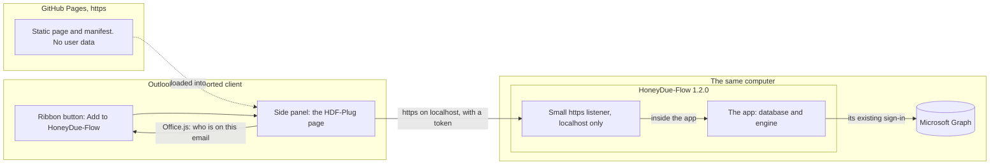

<div align="center">

# 🔌 HDF-Plug

### *Put the person you are reading about into a follow-up flow, without leaving Outlook.*

> ✨ *From the minds of IBM Bob & Daneyand* ✨

[](#-status-what-works-today)
[](https://github.com/007Style/honeyDue-Flow)
[](#️-which-outlook-is-supported)
[](#-license)
[](#-testing)
[](https://www.typescriptlang.org/)
[](https://react.dev/)

**🔒 Private by design · 🖥️ Talks only to HoneyDue-Flow on your own computer · 🚫 No server, no account, no telemetry**

[📌 Status](#-status-what-works-today) · [⬇️ Install](#️-download-and-install) · [🧭 The panel](#-the-panel-every-state) · [🔐 The certificate](#-the-certificate-and-why-it-is-needed) · [🛠️ Build from source](#️-building-from-source)

</div>

```text
   ╭───────────────────╮      ╭───────────────────╮      ╭───────────────────╮
   │ ✉️  An email in    │ ───▶ │ 🔌 Press "Add to   │ ───▶ │ 🍯 The person is   │
   │    Outlook        │      │ HoneyDue-Flow"    │      │  in a flow, with  │
   │ (sent or received)│      │ pick a flow, a    │      │  a start date and │
   │                   │      │ date and a time   │      │  time             │
   ╰───────────────────╯      ╰───────────────────╯      ╰───────────────────╯
                                        │
                  🛑 Not in Outlook Contacts, or a name, company
                     or email is missing?  The panel says why
                     and shows no form.
```

## 🔌 What is HDF-Plug?

HDF-Plug is an **Outlook add-in** for [HoneyDue-Flow](https://github.com/007Style/honeyDue-Flow) (HDF), the desktop follow-up engine. While you read an email in Outlook, you press one button, **Add to HoneyDue-Flow**. A side panel opens and:

1. 🔎 **Finds the person** on that email: the sender on a received email, the recipient on a sent one.
2. ✅ **Checks that the person is an Outlook contact** with a **first name, last name, email address and company**. These four are the minimum a flow needs.
3. 📋 If they qualify, lets you **search for and pick a flow** (a multi-step cadence or a single-step template), then pick a **start date and time**.
4. 🍯 Press **OK**, and the person goes into HoneyDue-Flow's **In Flow** tab exactly as if you had added them inside the app.
5. 🛑 If a person does **not** qualify, the panel gives the reason in plain words (not in your contacts, or which fields are missing) and shows no form.
6. 📭 If HoneyDue-Flow is not running, the panel says **"HoneyDue-Flow was not detected"** and applies nothing.

The add-in is deliberately thin. It holds **no contacts, no flows and no rules of its own**. Every decision (who is eligible, what flows exist, whether a start time is allowed) is made by HoneyDue-Flow, so the two can never disagree.

> 🍯 **The honey, in one line:** you read an email, you press one button, and the follow-up is on the calendar.

---

## 📌 Status: what works today

This repository is **in development**. Version 1.0.0 is not released. Be clear about what is real:

| Part | State | Notes |
|---|---|---|
| 🧱 Project, build, GitHub Pages publishing | ✅ **Built, running** | The page is live at <https://007style.github.io/HDF-Plug/> |
| 📜 Manifest for Outlook | ✅ **Built, tested as a file** | Generated by `tools/make-manifest.mjs`, published at <https://007style.github.io/HDF-Plug/manifest.xml>. Loading it into a real Outlook is the next test (see below) |
| 📭 "HoneyDue-Flow was not detected" panel | ✅ Built, tested | Tested with a fake HoneyDue-Flow, not yet in Outlook |
| 🤝 Connect to HoneyDue-Flow (Allow / Deny) | ✅ Built, tested | Same: tested against a faithful fake, not yet in Outlook |
| 🩺 Every "cannot go on" state (too old, switched off, not signed in) | ✅ Built, tested | See [The panel, every state](#-the-panel-every-state) |
| 👤 Reading the person from the email | ✅ Built, tested | Sender on a received email, recipients on a sent one, never yourself. Reads Outlook through Office.js, which is **not yet tried in a real Outlook** |
| ✅ Eligibility check (four fields) | ✅ Built, tested on both sides | The rule runs inside HoneyDue-Flow 1.2.0 |
| 📋 Flow picker with search, date and time | ✅ Built, tested | With HoneyDue-Flow's own warnings for a past time or a held time |
| 🍯 Putting the person into a flow | ✅ Built, tested on both sides | Uses the same code as HoneyDue-Flow's own Add Flow window |
| 🪟 Windows | 🧪 **Not tested yet** | Planned test on classic Outlook for Windows once the build is complete |

**The next milestone** is the first real test: load the manifest into Outlook for Mac, open the panel, connect, and add a person to a flow from a real email. Until that works end to end in Outlook, treat everything above marked "tested" as *tested with a fake*, not *proven in Outlook*.

HoneyDue-Flow's side is built in HoneyDue-Flow **1.2.0**, which this add-in needs.

---

## 📚 Table of contents

1. [📌 Status: what works today](#-status-what-works-today)
2. [🖥️ Which Outlook is supported](#️-which-outlook-is-supported)
3. [⬇️ Download and install](#️-download-and-install)
4. [🚀 A first session, step by step](#-a-first-session-step-by-step)
5. [🧭 The panel, every state](#-the-panel-every-state)
6. [✅ Who can be added: the four-field rule](#-who-can-be-added-the-four-field-rule)
7. [🔐 The certificate, and why it is needed](#-the-certificate-and-why-it-is-needed)
8. [🛡️ Privacy and security](#️-privacy-and-security)
9. [🏗️ Architecture](#️-architecture)
10. [🧭 Project layout](#-project-layout)
11. [🛠️ Building from source](#️-building-from-source)
12. [🧪 Testing](#-testing)
13. [📦 Releasing](#-releasing)
14. [🩺 Troubleshooting](#-troubleshooting)
15. [⚠️ Known limits](#️-known-limits)
16. [📖 Documentation map](#-documentation-map)
17. [📜 License](#-license)

---

## 🖥️ Which Outlook is supported

An Outlook add-in is a small web page that Outlook shows in a side panel, so the same page runs in every Outlook that supports add-ins. The author develops and tests on **one** of them. The table is explicit about that, so nobody has to guess.

| Outlook | Expected to work? | Tested by the author? |
|---|---|---|
| 🍎 **New Outlook for Mac** | ✅ Yes, this is the main target | ✅ **Yes**, throughout development |
| 🪟 **Classic Outlook for Windows** ("old Outlook") | ✅ Yes, same page | 🧪 **Once, at a planned "Windows gate"** after the build is complete. A failure there blocks the release |
| 🪟 **New Outlook for Windows** | ✅ Expected to work | ❌ **Not tested by the author** |
| 🌐 **Outlook on the web** | ✅ Expected to work | ❌ **Not tested by the author** |
| 📱 Outlook on iOS or Android | ❌ No | HoneyDue-Flow is a desktop app, so there is nothing on a phone for the add-in to talk to |
| 📧 Gmail or IMAP accounts inside Outlook | ❌ No | Outlook does not run add-ins for those account types |

"Expected to work" means the page and the manifest are the standard kind that Microsoft documents for all of those clients, and nothing in this add-in is specific to one client. It does **not** mean it was tried. If you try one of the untested ones, please say what happened by opening an issue.

**Two Outlook limits to know about** (both are Outlook's, not this add-in's, and both are in [Known limits](#️-known-limits)):

- Outlook for Mac **cannot grey out a ribbon button** (the programming interface for it is not there). So the button is always clickable, and the panel is where you are told why a person cannot be added.
- Outlook runs add-ins only for **Microsoft 365 and Outlook.com** mailboxes.

---

## ⬇️ Download and install

> ⚠️ **Before this works end to end you need two things:**
> 1. **HoneyDue-Flow 1.2.0 or later.** Download it from the [HoneyDue-Flow releases page](https://github.com/007Style/honeyDue-Flow/releases/tag/v1.2.0) (that repository is private, so you need to be invited).
> 2. The add-in itself, installed in Outlook as below.
>
> Both HoneyDue-Flow and Outlook must be on the **same computer**.

### 1. Open the install page

Open **<https://007style.github.io/HDF-Plug/>** in a web browser. Outside Outlook, the page shows how to install the add-in and the address to paste, with a **Copy address** button. **You do not have to download anything.**

The address Outlook needs is:

**`https://007style.github.io/HDF-Plug/manifest.xml`**

### 2. Add it to Outlook (sideloading)

This is the same on every Outlook that supports add-ins:

1. Press **Copy address** on the install page.
2. In Outlook, open <https://aka.ms/olksideload> (Outlook may open the page for you in a browser or inside the app).
3. Choose **My add-ins**.
4. Under **Custom Addins**, choose **Add a custom add-in**, then **Add from URL**. Paste the address and press **OK**.
5. Accept the warning that this add-in did not come from the store.

> **Add from URL is greyed out on the author's Mac (new Outlook for Mac).** Outlook decides this, not the add-in, and the cause is not known. If yours is greyed out or missing too, choose **Add from File** and use the **Download manifest.xml** link on the install page. **Add from File** is the way that has been followed and works on the Mac.

You should now see **Add to HoneyDue-Flow** in the ribbon when you open an email, and also when you write one. When writing a message, the button reads the **To** line only, and only when it holds exactly one person. Cc and Bcc are not read.

| Client | Notes |
|---|---|
| 🍎 New Outlook for Mac | Followed by the author. Works. |
| 🪟 Classic Outlook for Windows | A sideloaded add-in can take **up to 24 hours** to appear, according to Microsoft. Not yet followed by the author. |
| 🏢 A company mailbox | An administrator can instead upload the manifest in the Microsoft 365 admin center (**Integrated apps**) so everyone gets it. Not tested by the author. |

### 3. Set up the connection in HoneyDue-Flow

Do this **once**, in HoneyDue-Flow:

1. Open HoneyDue-Flow and go to **Settings**.
2. Find the **Outlook Add-in** card and press **Set up**.
3. HoneyDue-Flow makes a small certificate for your computer and asks your computer to trust it. Your computer asks for your approval. Why this is needed is in [The certificate](#-the-certificate-and-why-it-is-needed).

### 4. Connect the add-in

1. In Outlook, open any email and press **Add to HoneyDue-Flow**.
2. The panel says **Connect to HoneyDue-Flow**. Press **Connect**.
3. HoneyDue-Flow comes to the front and asks **Allow** or **Deny**. Press **Allow**.

You do this once. Nothing is typed. Afterwards the panel shows **Connected**.

### Removing it

- **In Outlook:** open <https://aka.ms/olksideload>, **My add-ins**, find *HoneyDue-Flow* under Custom Addins, and remove it.
- **In HoneyDue-Flow:** Settings, **Outlook Add-in**, revoke the connection, and use **Remove trust** to take the certificate out of your computer's trust store.

---

## 🚀 A first session, step by step

> This is the session as built. It has been tested against a fake HoneyDue-Flow, and not yet in a real Outlook (see [Status](#-status-what-works-today)).

1. **Start HoneyDue-Flow** and make sure it is signed in to Microsoft 365 (Settings, **Sign in with Microsoft**).
2. **Set up** the Outlook Add-in card once, and install the add-in in Outlook (see above).
3. **Press Connect** in the panel, then **Allow** in HoneyDue-Flow.
4. **Open an email** from someone who is in your Outlook Contacts with all four fields filled in.
5. **Press Add to HoneyDue-Flow.** The panel shows the person and the form.
6. **Search for a flow** and pick one. Multi-step cadences and single-step templates are listed in two groups.
7. **Pick a start date and time.** The default is 30 minutes from now, the same as HoneyDue-Flow's own Add Flow window. If the time is in the past or HoneyDue-Flow's business-hours or weekend shield would hold it, the panel warns you, using HoneyDue-Flow's own rules.
8. **Press OK.** The person appears in HoneyDue-Flow's **In Flow** tab. The first step runs at the time you chose.

---

## 🧭 The panel, every state

The panel is always in exactly one of these states. All the wording lives in one file, [`src/texts.ts`](src/texts.ts), and a test checks that every state has words.

### ✅ Built and tested (with a fake HoneyDue-Flow, not yet in a real Outlook)

| State | What you see | What to do |
|---|---|---|
| 🔄 **Checking** | "Looking for HoneyDue-Flow..." | Wait a moment |
| 📭 **Not detected** | **"HoneyDue-Flow was not detected."** It says HoneyDue-Flow must be installed and running, that it may be hidden in the system tray, and to open its **Settings, Outlook Add-in, Set up** if it is running and you still see this. Buttons: **Try again** and **Get HoneyDue-Flow** (opens the releases page) | Start HoneyDue-Flow, or finish Set up, then press **Try again** |
| ⬆️ **HoneyDue-Flow too old** | "Update HoneyDue-Flow to 1.2.0 or later to use this add-in." | Update HoneyDue-Flow |
| ⬆️ **Add-in too old** | "This add-in is out of date. Update it, then reopen this panel." | Re-install the manifest, then reopen the panel |
| 🔌 **Switched off** | "The Outlook add-in is switched off in HoneyDue-Flow Settings." | Switch it on in HoneyDue-Flow's Settings |
| 🔑 **Not connected** | "Connect this add-in to HoneyDue-Flow." Button: **Connect** | Press **Connect** |
| ⏳ **Waiting for Allow** | "Switch to HoneyDue-Flow and click Allow." Button: **Cancel** | Click **Allow** in HoneyDue-Flow |
| 🙅 **Not allowed / timed out / busy / locked** | A red line says what happened (Deny pressed, no answer in 60 seconds, another request is waiting, or too many refusals, with minutes to wait) and the button changes to **Try again** | Try again, or wait |
| 🔓 **Not signed in** | "HoneyDue-Flow is not signed in to Microsoft 365. Sign in from its Settings." | Sign in inside HoneyDue-Flow |
| 🟢 **Connected** | The email's person and the form below, and at the bottom "Connected to HoneyDue-Flow 1.2.0" with a **Disconnect** button | |
| 👤 **No person on the email** | "No other person on this email." (mail from or to yourself only) | Open another email |
| 📝 **Not an email** | "Open an email message to add the person on it to a flow." | Open a sent or received email |
| ✍️ **Writing a message: nobody on the To line** | "Put the person you are writing to on the To line, then press Check again." and **Check again** | Address the message, then **Check again** |
| ✍️ **Writing a message: more than one person on the To line** | "There are N people on the To line. This works with one person at a time..." and **Check again** | Leave one person on the To line, then **Check again** |
| ✍️ **Writing a message: one person on the To line** | The same form, and "Read from the To line: {email}" | Pick a flow and press **OK** |
| 🕵️ **Not in Outlook contacts** | "{email} is not in your Outlook contacts, so it can't be added to a flow." and **Check again** | Add the person to your Outlook contacts, then **Check again** |
| 📝 **Missing fields** | "This Outlook contact is missing: last name, company. Add them in Outlook, then press Check again." | Fix the contact in Outlook, then **Check again** |
| 🔁 **Already in a flow** | "{name} is already in the flow '{cadence}'. A contact can be in only one flow at a time." | Nothing; stop the flow in HoneyDue-Flow first if you want another |
| 📂 **No flows to choose** | "There are no flows or templates yet. Create one in HoneyDue-Flow first." | Create one in HoneyDue-Flow |
| 📋 **The form** | The person, a **Search flows** box, two groups (**Multi-step** and **Single step**, which includes "Phone call, no script"), a start date and time, and **OK, start flow**. OK stays off until a flow is chosen | Pick a flow, check the time, press **OK** |
| 👥 **Several people** (a sent email) | A choice of person, each marked "Can be added" or "Can't be added". Up to ten | Pick the person |
| 🚫 **A flow that is switched off** | Greyed in the list, with its reason | Fix it in HoneyDue-Flow |
| ⚠️ **Time warnings** | "This time has already passed..." or HoneyDue-Flow's own words when a shield would hold an email | Pick another time, or go ahead |
| ⏱️ **Adding** | "Adding..." and everything locked, so a double click cannot add twice | Wait |
| 🎉 **Success** | "{name} is in '{flow}'. First step: Fri Nov 20, 9:00 AM." with **Done**, and a warning if the calendar could not be updated | **Done** |
| ❌ **Failure** | HoneyDue-Flow's own words (busy, flow switched off, no longer eligible, and so on) and **Try again** | Try again |

The full table, with how each state is detected, is in section 5.3 of [`PLAN.md`](PLAN.md).

> 💡 **The panel stays open.** It is pinnable, so you can leave it open while you click from email to email. Each time you select a different email it looks again.

---

## ✅ Who can be added: the four-field rule

A person can go into a flow only if **all four** of these are true. HoneyDue-Flow checks them, in this order, and reports the first that fails:

1. 🔓 HoneyDue-Flow is **signed in to Microsoft 365**.
2. 📇 The person is in your **Outlook Contacts** (the default folder, or any contact folder), matched by **email address**, ignoring capital letters, against **any** address on the contact.
3. 📝 That Outlook contact has a **first name**, a **last name**, a **company** and an **email address**, none empty.
4. 🔁 The person is **not already in a flow**. (A person in **Out Flow**, stopped or finished, **can** be added again.)

Which person is chosen from an email:

- **Received email:** the sender.
- **Sent email:** the recipients (To, then Cc), leaving out your own address. One recipient is used. With several, they are listed, each with its own result.

> ℹ️ HoneyDue-Flow uses a contact's **first** email address. If the address on the email is a contact's *second* address, the person is still eligible, and the panel will show "Emails will go to {address}" so there is no surprise.

> ℹ️ The add-in **never writes to Outlook**. It cannot fill in missing fields. If a field is missing, fix it in Outlook and reopen the panel.

---

## 🔐 The certificate, and why it is needed

This is the one part of the setup that needs an explanation, because it is the one that asks your computer for approval.

**The problem.** The add-in page lives on the web (GitHub Pages). HoneyDue-Flow lives on your computer. For the page to talk to the app, the page has to call an address on your own computer, `localhost`. We tested this on Outlook for Mac: it **refuses** a plain `http://` call to `localhost`, and **allows** an `https://` one. So HoneyDue-Flow must answer over `https`, and `https` needs a certificate.

**The answer.** When you press **Set up**, HoneyDue-Flow makes **its own certificate, just for your computer**:

| | |
|---|---|
| **Made by** | HoneyDue-Flow, on your computer, using tools already on it (`openssl` and `security` on a Mac, PowerShell on Windows). Nothing is downloaded and nothing is shipped inside the app |
| **Shared between users?** | **No.** Every install makes its own. There is no certificate in this repository or in the app download |
| **Valid for** | `localhost` and `127.0.0.1` only |
| **Can it sign other sites?** | **No.** It is a plain server certificate, **not** a certificate authority |
| **Lifetime** | 365 days, renewed automatically when fewer than 30 remain |
| **Where the private key lives** | In HoneyDue-Flow's own data folder on your computer. It never goes in the database or in a backup, and it never leaves the computer |
| **Trusted for** | **Your user account only**, not the whole computer. No administrator rights |
| **Your approval** | Your computer asks once (a password prompt on a Mac, a confirmation on Windows) |
| **Taking it back** | Settings, Outlook Add-in, **Remove trust** |

Until you press **Set up**, HoneyDue-Flow's port is **closed**, and the add-in shows **"HoneyDue-Flow was not detected"** with a pointer to the Set up button.

> 🧪 **Honest note on testing.** The Mac certificate commands were run for real. The **Windows** commands were written from Microsoft's documentation and have **not been run** yet. They are first run at the Windows gate. Also not yet proven: Outlook accepting this certificate when the page comes from the real GitHub Pages address. That is the next test.

---

## 🛡️ Privacy and security

**What is sent, and to whom.** The add-in page is static. It sends data **nowhere except to HoneyDue-Flow on the same computer**: no analytics, no tracking, no cookies, no third-party calls. (It loads Microsoft's own `office.js` from Microsoft, which Outlook requires of every add-in.) The page holds no contacts, no flows and no secrets, and everything on it is public by design.

**What the add-in can do to HoneyDue-Flow.** Only six things: say hello, ask to connect, check one person, list the flow choices, check a start time, and add a person to a flow. It cannot read your contact list, your template text, your notes, your tokens or your settings, and it cannot send email. The exact contract is in [`BRIDGE-API.md`](BRIDGE-API.md).

**The layers** (each is a test in HoneyDue-Flow):

1. 🟢 On by default and **switchable off** in HoneyDue-Flow's Settings. Until you approve an add-in, the port answers only "hello" and a connect request.
2. 🔒 Bound to the **loopback address only**, never reachable from the network, and `https` only.
3. 🌐 **One allowed web address.** A request from any other web page gets no permission headers and no prompt.
4. 🧭 A **Host header check**, so a hostile web page cannot trick your browser into reaching it by a rebinding trick.
5. 🙋 **Approve once.** HoneyDue-Flow asks with a **system dialog from the app itself**, with Deny as the default. A web page can neither fake it nor press it. Only after **Allow** is a token made. It has 256 random bits and only its **hash** is stored. After three refusals or time-outs in a row, new requests are refused for 10 minutes.
6. 🔬 The smallest possible set of actions (above).
7. 🚦 A rate limit (60 calls a minute).
8. 📜 Logs record that a call happened, **not the email addresses or names**.
9. ✂️ **Revoke** any time in Settings. Switching the add-in off closes the port at once.

**An honest limit.** A web page cannot fake the web address it comes from, which stops other websites. Another *program* on the same computer could pretend to be that page, but it still cannot get a token unless **you click Allow**.

To report a security problem, contact the owner through the GitHub account [007Style](https://github.com/007Style).

---

## 🏗️ Architecture



**Why it is built this way**

- **The page is hosted on the web, not served by HoneyDue-Flow.** Outlook never keeps an add-in on your computer. It opens a web address in the panel, like a browser tab. A page on the web is always reachable, which is what lets it say **"HoneyDue-Flow was not detected"** when the app is closed. One manifest, one page address, one allowed origin.
- **HoneyDue-Flow still needs a small listener.** The page can only make web requests, and HoneyDue-Flow's database is not a file the page can reach. So the app listens on `https://localhost` and does the real work.
- **The add-in cannot write to HoneyDue-Flow's database directly.** The database lives in memory inside the app window and is rewritten whole on every save, so an outside edit would be lost or would corrupt it. Adding a person to a flow is also more than one table row: it imports the person from Outlook using the app's own Microsoft sign-in, checks the rules, and creates the calendar and to-do entries. All of that is the app's code.
- **There is no Outlook contacts API in the add-in programming interface.** So the add-in asks HoneyDue-Flow, which already reads your contacts through Microsoft Graph and already applies the four-field rule. No second sign-in is needed.
- **If HoneyDue-Flow is closed, nothing is queued.** The add-in could not check the four fields or read the flow list, so mistakes would surface later and silently. It says "not detected" instead. HoneyDue-Flow can optionally **start when you sign in** to your computer, to make that rare.

The longer version, with the research behind each decision, is in [`PLAN.md`](PLAN.md) and [`RESEARCH.md`](RESEARCH.md).

---

## 🧭 Project layout

```text
HDF-Plug/
├── index.html                  The panel page (loads Microsoft's office.js)
├── public/
│   ├── commands.html           Required by the manifest, does nothing yet
│   └── assets/                 The ribbon icons (16, 32 and 80 pixels)
├── src/
│   ├── main.tsx                Starts the panel once Outlook is ready
│   ├── texts.ts                Every message the panel can show, in one table
│   ├── bridge/
│   │   ├── types.ts            The shapes in BRIDGE-API.md, the port range, the API version
│   │   └── client.ts           Talks to HoneyDue-Flow; never throws for a network problem
│   ├── state/panel.ts          The state machine (no React, no Outlook, so it is tested alone)
│   ├── office/host.ts          The ONLY file that touches Office.js
│   └── components/App.tsx      Draws each state
├── tools/
│   ├── make-manifest.mjs       Writes manifest/manifest.xml for a page address
│   └── fake-bridge/            A real https fake of HoneyDue-Flow, for tests
├── tests/                      68 tests (client, panel, app, manifest)
├── .github/workflows/pages.yml Tests, builds and publishes to GitHub Pages
├── PLAN.md                     The design record
├── BRIDGE-API.md               The contract between the add-in and HoneyDue-Flow
├── RESEARCH.md                 What was checked, how, and how sure we are
└── LICENSE
```

The rule behind the layout: **everything that is specific to Outlook sits behind `src/office/`**, so a change in Outlook touches one file.

---

## 🛠️ Building from source

You need **Node.js 20 or newer**. To exercise the client tests you also need `openssl` (it is on every Mac and on Git for Windows).

```bash
git clone https://github.com/007Style/HDF-Plug.git
cd HDF-Plug
npm install
npm run dev          # the panel in a browser at http://localhost:5173/HDF-Plug/
npm run build        # type check, build into dist/, and write manifest/manifest.xml
```

`npm run dev` opens the panel **outside Outlook**, where it can still look for HoneyDue-Flow and show its states. It cannot read an email there. `npm run build` writes `dist/` (the page) and `manifest/manifest.xml` (not committed; the build makes it).

To build a manifest that points at a **different** address, for example your own test host:

```bash
node tools/make-manifest.mjs https://example.com/HDF-Plug
```

> ⚠️ **Do not change the add-in id** inside `tools/make-manifest.mjs`. Outlook uses it to tell an *update* from a *different add-in*.

> ⚠️ HoneyDue-Flow accepts requests from **one** fixed web address only (the GitHub Pages one). A page served from anywhere else can load, but HoneyDue-Flow will refuse to talk to it. That is deliberate (see [Privacy and security](#️-privacy-and-security)).

---

## 🧪 Testing

```bash
npm test             # all tests
npm run typecheck    # TypeScript only
npm run verify       # typecheck + tests (what the publish workflow runs first)
```

State today: **4 test files, 68 passing tests.**

| Test file | Ids | What it covers |
|---|---|---|
| `tests/client.test.ts` | `PLG-C01` to `C12` | The bridge client against a **real https fake** of HoneyDue-Flow: finding the port, version checks, connect, Allow, Deny, expiry, token kept and forgotten |
| `tests/panel.test.ts` | `PLG-P`, `N`, `S`, `T` | Which state shows for each HoneyDue-Flow answer; connect waiting, Cancel, a late answer after Cancel, two refreshes at once; the platform name; every message is non-empty |
| `tests/app.test.tsx` | `PLG-U01` to `U09` | What each state looks like and which button calls what |
| `tests/manifest.test.ts` | `PLG-M01` to `M10` | The manifest: well-formed, fixed id, version, read-only permission, every address, one app domain, pinning, every resource is defined |

Rules the tests follow: **no real network, no real tokens, no real mail.** A test title starts with its case id. The client tests run against a fake that speaks the real protocol over a real `https` socket, so the add-in's own port and certificate handling is what is tested.

**What automation cannot reach** is real Outlook. That is a manual matrix, run by hand:

| Client | Result required |
|---|---|
| New Outlook for Mac | Every state, connect, and add-to-flow end to end. **Release blocker** |
| Classic Outlook for Windows | The same. **Release blocker.** Run once, at the Windows gate |
| New Outlook for Windows, Outlook on the web | Not tested by the author |
| Sent, received, reply and forwarded email | The correct person each time |
| HoneyDue-Flow closed, hidden in the tray, window open | "Not detected" versus ready |

The tests for HoneyDue-Flow's side of the connection (65 cases, ids `BRG-…`) live in the HoneyDue-Flow repository.

---

## 📦 Releasing

1. Both sides are tagged together: **HoneyDue-Flow 1.2.0** and **HDF-Plug 1.0.0**.
2. `npm run verify` must pass, and the manual matrix above must pass.
3. Every push to `main` runs the **publish workflow**: type check, tests, build, then publish to GitHub Pages. A failing test stops the publish, so a broken page is never served.
4. Tag: `git tag -a v1.0.0 -m "HDF-Plug 1.0.0"` and `git push origin v1.0.0`.
5. The manifest is published next to the page at `/manifest.xml`.

The two sides can be updated **one at a time**. The connection has its own version number (`apiVersion`, currently `1`), and each side refuses a number it does not know and says which one to update.

> ⚠️ **Changing the page address later is expensive.** It is written into every installed manifest **and** into HoneyDue-Flow. Moving it means a new HoneyDue-Flow release and a reinstall for every user. A custom domain you own would let the host change without any user action.

---

## 🩺 Troubleshooting

| What you see | Likely cause and fix |
|---|---|
| **"HoneyDue-Flow was not detected"** | HoneyDue-Flow is not running (it may be hidden in the system tray, so open it), or it is not installed, or **Set up was never pressed**. Open HoneyDue-Flow, **Settings, Outlook Add-in, Set up**, then press **Try again** in the panel |
| The same message after **Set up** | Your computer was not given approval for the certificate, or it was removed. Press **Set up** again and approve. Also check that no other program is using ports 47615 to 47624 |
| **"Update HoneyDue-Flow to 1.2.0 or later"** | HoneyDue-Flow is older than the add-in needs. Update it |
| **"This add-in is out of date"** | HoneyDue-Flow is newer than this add-in. Remove and re-add the manifest, then reopen the panel |
| **"The Outlook add-in is switched off"** | Switch it on in HoneyDue-Flow's Settings |
| **"Not allowed"** | Deny was pressed, or the dialog was closed. Press **Try again** |
| **"Timed out"** | HoneyDue-Flow got no answer to the Allow question within 60 seconds. Switch to HoneyDue-Flow, and press **Try again** |
| **"Too many requests were refused"** | Three refusals or time-outs in a row. Wait the time shown, then try again |
| **"HoneyDue-Flow is not signed in to Microsoft 365"** | Sign in inside HoneyDue-Flow |
| The button is **not in the ribbon** | The add-in shows for **a message you have open**, not a folder view. Open an email. Classic Outlook can take up to 24 hours to show a new sideloaded add-in. The add-in does not run for Gmail or IMAP accounts |
| The button is there but **never greys out** | By design. Outlook cannot grey out a button on a Mac. The reason is in the panel |
| Asked to **Connect** again | The panel's saved connection was cleared (Outlook clearing its storage, or a revoke in HoneyDue-Flow). Press **Connect** and **Allow** again |

---

## ⚠️ Known limits

- **Tried by the author only in new Outlook for Mac so far.** The compose-window button has not yet been tried in a real Outlook, and nothing has been tried on Windows (see [Status](#-status-what-works-today)).
- **Needs HoneyDue-Flow 1.2.0 or later.**
- **Same computer only.** Outlook and HoneyDue-Flow must run on the same machine.
- **Needs the internet** to load the panel, because Outlook fetches the page from the web. HoneyDue-Flow itself does not need it for this.
- **HoneyDue-Flow must be running.** Nothing is queued while it is closed.
- **Microsoft 365 and Outlook.com mailboxes only.** Outlook does not run add-ins for Gmail or IMAP accounts, and HoneyDue-Flow does not support them on Windows either.
- **People not in Outlook Contacts cannot be added**, and the add-in cannot fill in missing fields. It never writes to Outlook.
- **Your own address.** If your mailbox address differs from the one HoneyDue-Flow signs in with (for example an alias), the add-in may offer **you** as the person and then say "not in contacts".
- **Two Outlook accounts, or a shared mailbox,** are not supported in 1.0.0.
- **One person at a time.** No multi-select. When writing a message, only a single person on the To line works. No removing, pausing or editing a flow from Outlook.
- **No store listing.** It is installed from a manifest file or by an administrator, not from Microsoft AppSource.
- **Not tested by the author:** new Outlook for Windows and Outlook on the web (expected to work). Classic Outlook for Windows is tested once at the Windows gate.
- **Unproven so far:** the compose-window button (and whether Outlook tells the panel when the To line changes, which is why **Check again** is there); and everything on Windows (including the Windows certificate commands).
- **No code signing.** Like HoneyDue-Flow, nothing here is signed or notarized.

---

## 📖 Documentation map

| File | What is in it |
|---|---|
| [`README.md`](README.md) | This tour |
| [`PLAN.md`](PLAN.md) | The project plan, every decision and why, the phases, the risks and the acceptance checklist |
| [`BRIDGE-API.md`](BRIDGE-API.md) | The exact contract between the add-in and HoneyDue-Flow: every address, field and error |
| [`RESEARCH.md`](RESEARCH.md) | What was checked, how it was checked, and how sure we are, including the Outlook for Mac tests |
| [`docs/INSTALL.md`](docs/INSTALL.md) | Install steps, written from real installs |
| [`docs/TROUBLESHOOTING.md`](docs/TROUBLESHOOTING.md) | What each message means and what to do about it |
| [`docs/SECURITY.md`](docs/SECURITY.md) | What the add-in can reach, what it sends, and the certificate |
| [`docs/ARCHITECTURE.md`](docs/ARCHITECTURE.md) | How the panel is built and how its parts fit together |
| [`AGENTS.md`](AGENTS.md) | Rules for anyone (or any assistant) changing this repository |
| [`LICENSE`](LICENSE) | The license |

HoneyDue-Flow's own documents are in its [repository](https://github.com/007Style/honeyDue-Flow).

---

## 📜 License

**HDF-Plug is proprietary commercial software. All rights reserved.** Copyright © 2026 Daneyand.

Having access to this repository, the page, or the manifest does **not** give you permission to use the software. The source is public so that you can read how it works and check what it does on your computer, **not** so that it can be used, copied, changed or redistributed without permission. You need a written authorization from the licensor. Without one you may not use, copy, modify, distribute, host, resell or reverse engineer the software.

The full terms are in [`LICENSE`](LICENSE). Third-party components keep their own open-source licenses.

For licensing questions, contact the owner through the GitHub account [007Style](https://github.com/007Style).

---

<div align="center">

🔌 **HDF-Plug** · v1.0.0 (in development) · for 🍯 **HoneyDue-Flow**

*From the minds of IBM Bob & Daneyand*

*Read the email. Press the button. Let the follow-up begin.* 🐝

</div>
