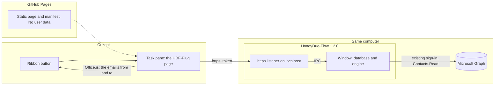

# 🏗️ Architecture

The design record is [`PLAN.md`](../PLAN.md); the contract between the two programs is [`BRIDGE-API.md`](../BRIDGE-API.md); the facts it rests on are in [`RESEARCH.md`](../RESEARCH.md). This page is the short version.

## The shape

## Why it is built this way

- **A hosted page.** Outlook loads an add-in from a web address; it never keeps the program on your computer. So the page sits on GitHub Pages and holds no data.
- **A local listener in HoneyDue-Flow.** A web page can only send web requests, and HoneyDue-Flow's database is not a file the page can reach. So HoneyDue-Flow listens on `https://localhost` and does the work.
- **https, not http.** Outlook on a Mac refuses plain `http` to localhost (RESEARCH D). So HoneyDue-Flow makes its own certificate, which you approve once.
- **A thin add-in.** It holds no contacts, flows or rules. Who is eligible, which flows exist and whether a time is allowed are all decided inside HoneyDue-Flow, so the two cannot disagree. The add-in reuses HoneyDue-Flow's own add-to-flow code (the same function the Add Flow window uses).
- **The window does the data work.** The listener is in the main process. It passes each request to the app window, which already owns the database and the Microsoft sign-in, with a 25-second limit.

## The add-in's own layers (`src/`)

| Layer | Files | Rule |
|---|---|---|
| Office.js | `office/host.ts` | The **only** file that touches Office.js. Everything else gets plain values |
| Reading the email | `office/people.ts` | Plain values in and out, so it is tested without Outlook |
| The bridge client | `bridge/client.ts`, `bridge/types.ts` | Never throws for a network problem. A bad answer is a failure, not a crash |
| Connect states | `state/panel.ts` | One state machine: not detected, too old, switched off, connect, waiting, not signed in, connected |
| What happens once connected | `state/session.ts` | The email's person, the flow list, the time, the add. Drops any answer that arrives after the user has moved on |
| The screen | `components/` | No logic of its own beyond display |
| Words | `texts.ts` | Every message in one table |

## Decisions worth knowing

- **One person at a time**, one flow at a time per person.
- **A request in flight is never trusted after the user moves to another email.**
- **A double press cannot add twice**: the button locks, the session ignores a second press, and HoneyDue-Flow refuses a second pending flow. Adds are also served one after another.
- **No greyed ribbon button.** Outlook for Mac cannot do it, so the panel explains instead.
- **Not in v1:** queueing while HoneyDue-Flow is closed, an "open HoneyDue-Flow" link, a button on contacts (Outlook add-ins do not run there).
